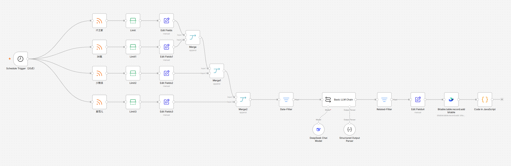
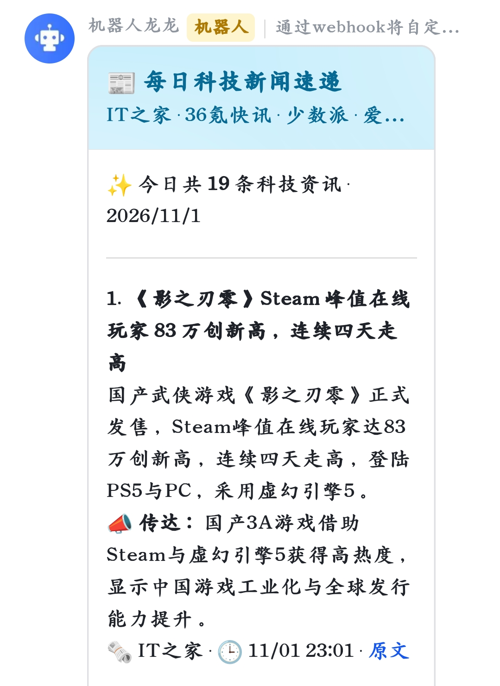
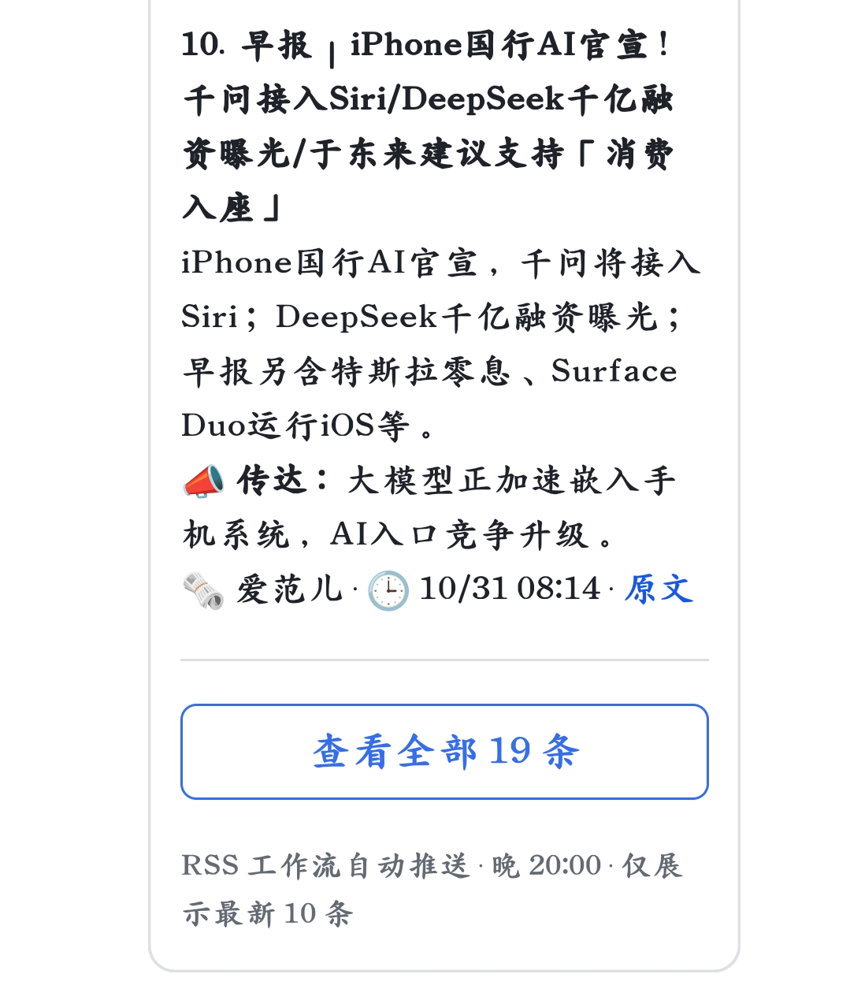
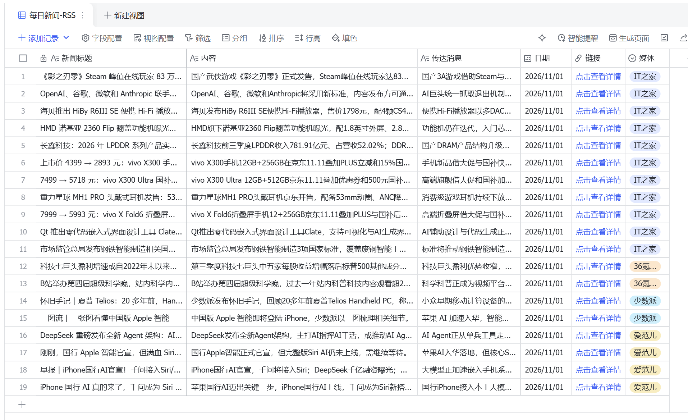
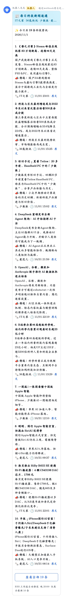
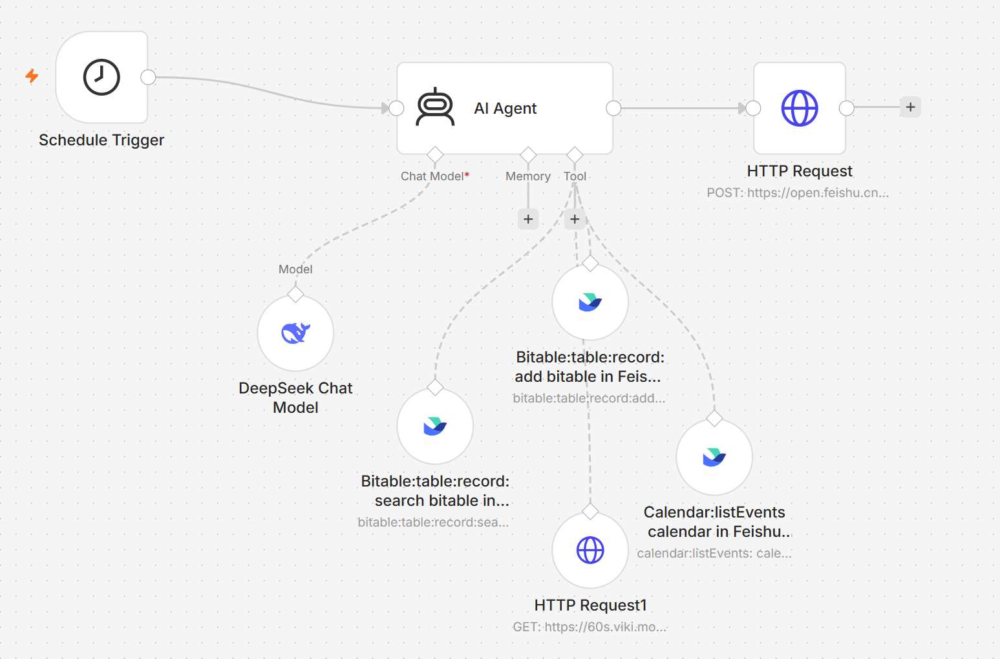
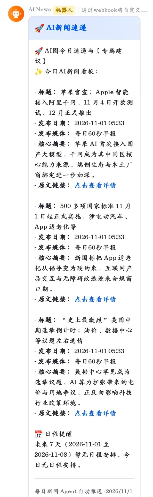
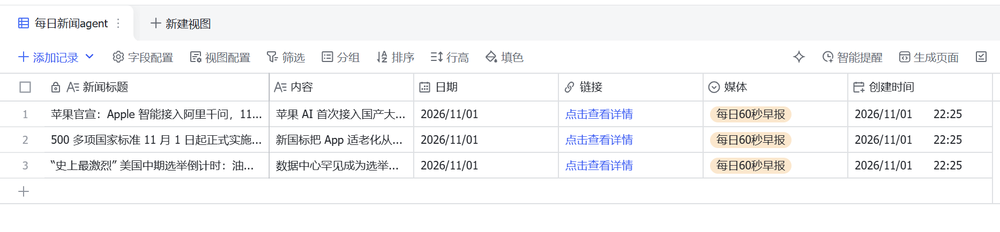
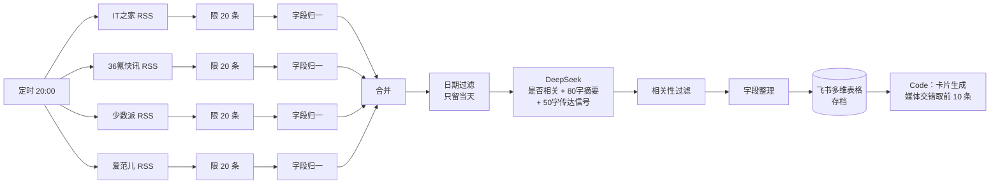
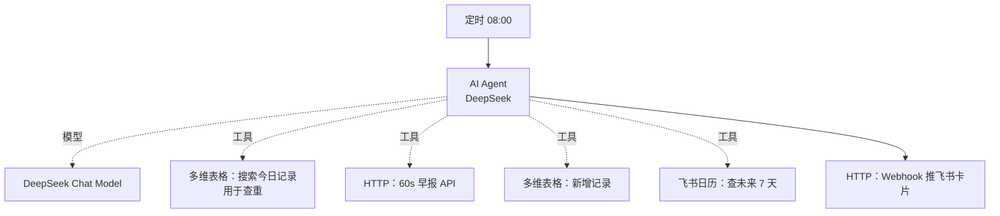

# AI 资讯推送系统 · 从 Workflow 到 Agent

> 每天自动抓 4 个科技媒体的 AI 新闻，过滤出真正相关的，写一句「这意味着什么」，推成一张飞书卡片。  
> 先做了确定性流水线，发现扩展性问题后重构成 Agentic 方案——这个仓库记录两版和中间的取舍。

**技术栈**：n8n + DeepSeek + 飞书多维表格 + 飞书消息卡片 + HTTP / RSS

---

## 成品与工作流

**V1 流水线版 · 24 节点完整画布**（4 源并行 → 合并 → 日期过滤 → LLM 判断 → 入库 → 卡片）



**V1 推送成品**：卡片头部实时显示「今日共 19 条」，正文按媒体交错取前 10 条，底部「查看全部 19 条」按钮收尾；同日多维表格存档 19 条（IT之家 11 / 爱范儿 4 / 36氪 2 / 少数派 2），四家媒体标签齐全。







<details>

<summary>查看完整 10 条卡片长图</summary>



</details>

**V2 Agent 版 · 单 Agent + 4 个工具**（多维表格查重/写入、资讯 API、飞书日历）



**V2 推送成品**：飞书卡片含新闻摘要、解读与「日程提醒」区块；每条新闻同步写入多维表格存档，含标题 / 内容 / 日期 / 链接 / 媒体字段。





---

## 一、两版对比

|      | V1 流水线版（`workflow/daily-news-workflow.json`） | V2 Agent 版（`workflow/daily-news-agent.json`） |
| ---- | -------------------------------------------- | -------------------------------------------- |
| 编排方式 | 24 个节点显式编排                                   | 1 个 AI Agent + 4 个工具                         |
| 数据源  | 4 个 RSS（IT之家 / 36氪快讯 / 少数派 / 爱范儿）            | 「每日60秒」聚合 API + 可插拔 HTTP 工具                  |
| 去重   | 无（靠日期过滤）                                     | Agent 先查多维表格今日记录，命中即跳过                       |
| 筛选方式 | LLM 输出结构化布尔值 `related` 后硬过滤                  | 模型在提示词 SOP 内自主判断 3~5 条                       |
| 附加价值 | 无                                            | 附未来 7 天日程提醒（飞书日历）                            |
| 触发时间 | 每天 20:00                                     | 每天 08:00                                     |
| 可控性  | 高（每步可单测）                                     | 中（依赖模型遵守 SOP）                                |
| 扩展成本 | 加一个源要改 3 处编排                                 | 加一个源只需加一个工具节点                                |

### 关于数据源为什么变了

两版的数据源不同（V1 是 4 个 RSS，V2 是 1 个聚合 API），这不是随意换的，而是**数据源形态要匹配编排范式**：

- **V1 追求「不漏」**：4 个 RSS 一天几百条，全部过一遍 LLM 逐条判断相关性。召回高、精度低（宁可错杀一千，绝不放过一个）、token 成本高，但流程可控、可逐条排障。
- **V2 追求「少而准」**：Agent 输入越少，判断越准、成本越低。聚合 API 每天固定 10 条且已人工筛过，模型只需在里面挑 3~5 条最相关的，同时把省下的 token 预算用于「查重 + 日程提醒」这类真正需要判断的步骤。

一句话：**流水线适合「宽输入 + 硬过滤」，Agent 适合「窄输入 + 自主挑选」。**

所以 V2 不是 V1 的完全替代，而是并行的另一条线——V1 保底（准点、可控、成本可预估），V2 做增量（灵活加源、组合多系统）。真正上生产时，我的选择是两者并存。

## 二、V1：为什么是流水线



三个关键设计：

1. **结构化输出而不是解析文本**：用 Structured Output Parser 约束模型返回 `{related, summary, message}`，拿 `related` 做硬过滤。模型只负责判断，不负责编排。
2. **「传达信号」字段**：除了摘要「发生了什么」，额外让模型输出 50 字「这意味着什么」。这是资讯产品的价值差异——用户要的不是标题，是判断。
3. **按媒体交错排版**：如果直接取前 10 条，更新最快的源（36氪快讯）会独占版面。Code 节点按「IT之家 1 条 → 36氪 1 条 → 少数派 1 条 → 爱范儿 1 条」轮询，保证四家媒体在前 10 条里都能露出。

## 三、V2：为什么改成 Agent

V1 跑稳之后暴露三个问题：**加数据源要改编排**（一处漏改就断链）、**没有查重**（同一新闻多源转载会重复入库）、**无法组合外部信息**（想加日程提醒得再开一条支线）。

V2 把「怎么抓、抓几条、要不要写库」交给模型，人只维护工具和 SOP：



提示词写死四步 SOP：**① 查重 → ② 抓取并挑 3~5 条最相关的 → ③ 按固定 JSON 结构写库 → ④ 查日程 → 输出卡片 Markdown**。

踩过的坑：让模型自由发挥「链接字段怎么写」，它会写成字符串而不是 `{text, link}` 对象，导致写库失败。解决办法是在提示词里给出**完整请求体示例**并明确「链接字段是对象、日期是毫秒时间戳数字」。

## 四、目录结构

```
.
├── workflow/
│   ├── daily-news-workflow.json   # V1 流水线版（脱敏）
│   └── daily-news-agent.json      # V2 Agent 版（脱敏）
├── docs/
│   ├── 01-需求与方案对比.md
│   ├── 02-V1-流水线设计.md
│   └── 03-V2-Agent设计.md         # 含完整 SOP 提示词
└── assets/                       # 两个版本的节点截图、卡片效果图、多维表格截图
    ├── V1/                       # 工作流画布、卡片首尾截图、完整长图、多维表格
    └── V2/                       # Agent 画布、推送卡片、多维表格
```

## 五、运行数据

> **V1 口径**：2026-11-01 15:04 完整执行（4 源合并 → 日期过滤 → LLM 逐条判断 → 入库 → 推送，耗时 101s）  
> **V2 口径**：2026-11-01 14:25 完整执行（单 Agent 自主编排 4 个工具，耗时 31s）

**V1 流水线版**

| 指标             | 数值                                       |
| -------------- | ---------------------------------------- |
| 单次抓取条数（4 源合并后） | 47 条（IT之家 20 / 36氪快讯 20 / 少数派 3 / 爱范儿 4） |
| 日期过滤后入库        | 19 条（卡片正文展示前 10 条）                       |
| LLM 相关性过滤命中率   | 19 / 47 ≈ 40%                            |
| 单次执行耗时         | 101s                                     |

**V2 Agent 版**

| 指标     | 数值                                                      |
| ------ | ------------------------------------------------------- |
| 工具调用   | Agent 单次自主发起 9 次工具调用（资讯 API 取新闻、多维表格写入、飞书日历），无需人工编排先后顺序 |
| 多维表格入库 | 3 条（含查重后的写入）                                            |
| 单次执行耗时 | 31s，约为 V1 的 1/3（窄输入 + 少量 LLM 决策，替代 V1 的 47 条逐条判断）       |

**运行记录**：首次运行 2026-10-29，10-31 起接入每日定时；两版均为真实执行，数据取自 n8n 执行历史。

## 六、快速复现

1. n8n 中 `Import from File` 导入 `workflow/*.json`
2. 配置 DeepSeek 凭证（V1 用于 LLM Chain，V2 用于 Agent）
3. 飞书侧：建自建应用 → 开通多维表格读写权限 → 建数据表（字段见 `docs/02`）→ 建群机器人拿 Webhook
4. 把 JSON 里的占位符替换成自己的值：
   - `<YOUR_BITABLE_APP_TOKEN>` / `<YOUR_BITABLE_TABLE_ID>`
   - `<YOUR_FEISHU_WEBHOOK_TOKEN>`
   - `<YOUR_TENANT>.feishu.cn`（多维表格分享链接）
5. 手动执行一次跑通，再打开 Active

## 七、脱敏说明

- 飞书机器人 Webhook、多维表格 app_token / table_id、租户子域名、n8n 凭证引用全部替换为占位符
- 不含任何 API Key
- `active` 统一置为 `false`，导入后不会直接触发
